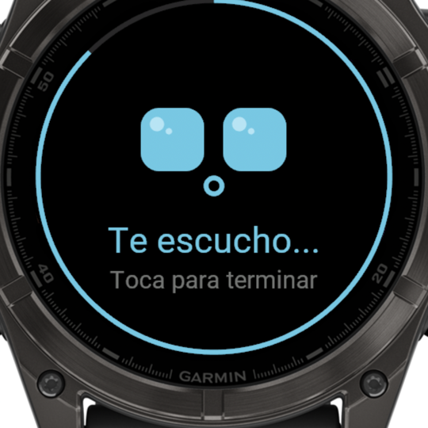
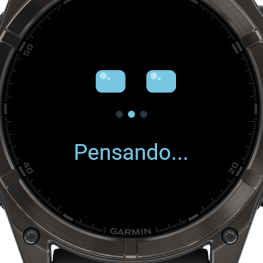
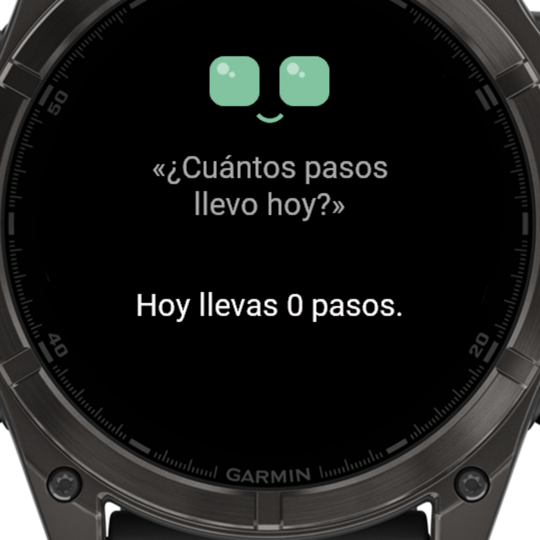
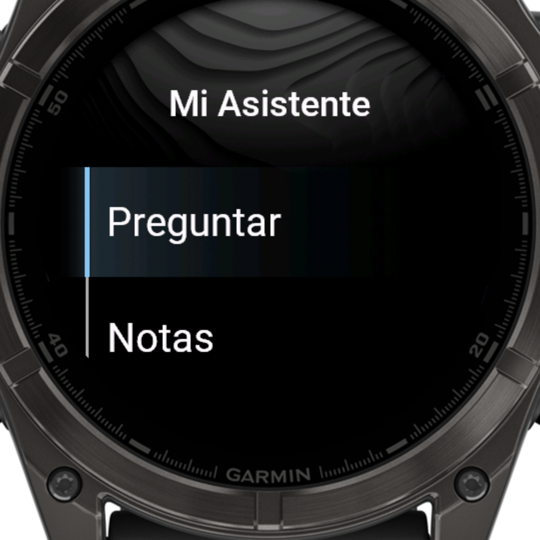
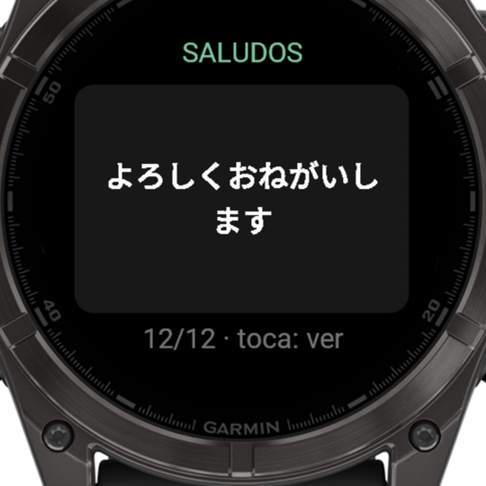
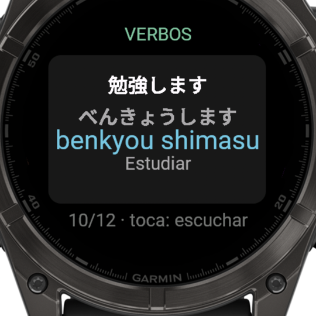
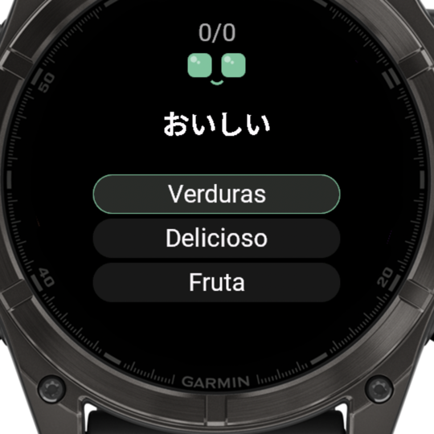
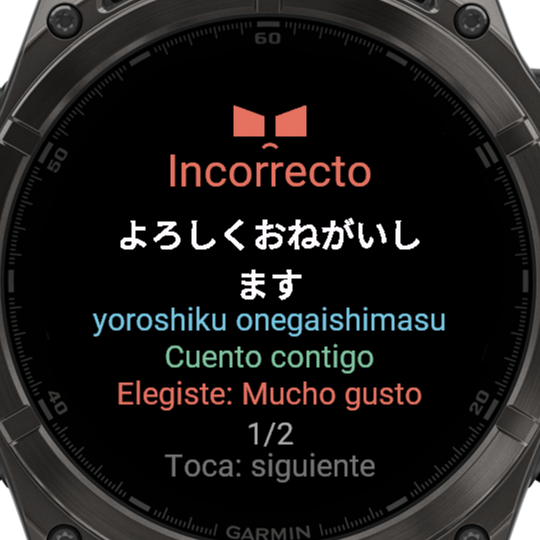
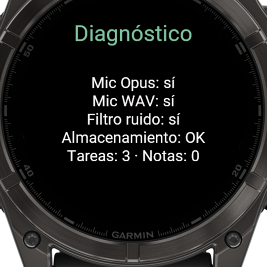

# Mi Asistente — Garmin fēnix 8

Asistente personal con voz para el **Garmin fēnix 8 47mm AMOLED**, hecho con
Connect IQ (Monkey C) y un backend en Vercel. Le preguntas hablando y responde
en pantalla y por el altavoz del reloj, usando tus tareas, tus notas y los
datos del propio reloj. Incluye práctica de japonés N5.

La cara sigue el estilo de [Monki](https://github.com/Niicko12/monki), el
asistente de la Anbernic RG353V, pero es un asistente aparte: no usa su
palabra de activación ni se conecta con él.

<p align="center">
  
  
  
</p>

<sub>Capturas del simulador de Connect IQ (fēnix 8 47mm). Los datos de actividad del simulador son ficticios.</sub>

## Qué hace

| Función | Detalle |
|---|---|
| **Preguntar por voz** | Al abrir la app empieza a escuchar (hasta 12 s; toca para terminar). El audio va al backend, se transcribe y se responde. |
| **Responde en voz alta** | La respuesta suena por el altavoz del reloj, por frases, mientras la boca se anima. |
| **Datos del reloj** | Cada pregunta lleva batería, pasos, calorías, distancia, pisos, minutos de intensidad, pulso actual y en reposo, Body Battery, estrés, SpO2, respiración, recuperación, VO2máx, horario de sueño, clima y amanecer/atardecer. |
| **Tareas y notas** | Se guardan en el reloj; las notas usan plantillas o el teclado. Las pendientes viajan como contexto. |
| **Japonés N5** | Tarjetas con lectura, romaji, significado y pronunciación; quiz de 3 opciones que repite lo que fallas; quiz de hiragana; racha de días. Los verbos van en forma cortés ます y se traducen conjugados: たべます = «como (comer)». |
| **Panel en el teléfono** | Menú → Configurar (QR) abre en el iPhone [/api/setup](https://mi-asistente-garmin.vercel.app/api/setup): agregar tareas, notas y tarjetas de japonés (la IA completa lectura, romaji y significado) y poner las claves de IA. El reloj lo recoge al abrir su menú. |
| **Estados visuales** | Ojos estilo Monki: disponible, escuchando, pensando, hablando, sin conexión y error. |

<p align="center">
  
  
  
  
</p>
<p align="center">
  
  
</p>

## Cómo funciona

```text
fēnix 8 ──BLE──▶ iPhone (Garmin Connect) ──HTTPS──▶ Vercel (integration-service)
  │                                                    │
  │  micrófono: Ogg/Opus 16 kHz                         ├─ Voz a texto: Whisper (Groq)
  │  datos del reloj + tareas + notas                   ├─ Respuesta: Groq ─▶ NVIDIA ─▶ Gemini
  │                                                    └─ Texto a voz: Gemini ─▶ Google Cloud ─▶ Edge
  ◀── respuesta (JSON) y voz por partes (Ogg/Opus en base64)
```

- **Las claves de IA nunca están en el reloj.** El reloj solo conoce un token de dispositivo.
- **Respaldo en cadena**, como en Monki: si un proveedor falla o se queda sin cuota, se usa el siguiente; el que se queda sin cuota se salta 10 minutos.
- **Voz por partes:** el reloj rechaza respuestas web grandes (~27 KB fallaba, ~5–9 KB funciona). El texto se parte en frases y el reloj pide la siguiente mientras suena la actual.
- **Fuente japonesa propia:** las fuentes del sistema no tienen kana ni kanji; `tools/make_font.py` genera una fuente BMFont con todo el hiragana y katakana más los kanji del mazo (223 caracteres). Las tarjetas del teléfono con kanji fuera de la fuente se muestran con su lectura en kana.
- **Panel y claves:** lo que se agrega desde el teléfono y las claves de IA se guardan en un Blob privado de Vercel; las claves van cifradas (AES-256-GCM con una clave derivada de `DEVICE_TOKEN`) y tienen prioridad sobre las variables de entorno.

## Estructura

```text
mi-asistente-garmin/
├── garmin-connect-iq/          app del reloj (Monkey C)
│   ├── manifest.xml
│   ├── Secrets.mc.example      plantilla de URL y token (Secrets.mc no se versiona)
│   ├── resources/              textos, icono, QR de configuración y fuente japonesa
│   └── source/
│       ├── ListenView.mc       escuchar ▶ enviar ▶ responder
│       ├── AnswerPanel.mc      respuesta con texto partido para pantalla redonda
│       ├── SpeechPlayer.mc     voz por partes con Audio.Output
│       ├── VoiceRecorder.mc    micrófono con Audio.Capture
│       ├── WatchData.mc        datos del reloj que viajan con cada pregunta
│       ├── EyesRenderer.mc     cara estilo Monki
│       ├── Jp*.mc, JapaneseDeck.mc   práctica de japonés
│       ├── SetupQrView.mc      QR del panel del teléfono
│       ├── PhoneSync.mc        recoge tareas, notas y tarjetas del panel
│       ├── JpCustom.mc         tarjetas de japonés del teléfono
│       ├── JpCharset.mc        caracteres de la fuente (generado)
│       └── Theme.mc            colores compartidos
├── integration-service/        backend en Vercel (Node.js + TypeScript)
│   ├── api/ask.ts              pregunta escrita
│   ├── api/ask-audio.ts        pregunta hablada
│   ├── api/speak.ts            voz por partes
│   ├── api/setup.ts            panel y guía para el teléfono (página HTML)
│   ├── api/config.ts           lo que usa el panel: claves, bandeja y tarjetas
│   ├── api/sync.ts             el reloj recoge lo agregado en el panel
│   └── lib/                    proveedores de IA, voz, config (Blob) y codificador Ogg/Opus
├── tools/
│   ├── mtp_send.py             instalar en el reloj por MTP
│   └── make_font.py            generar la fuente japonesa y JpCharset.mc
└── docs/                       plan, validación de capacidades, capturas y mockup
```

## Puesta en marcha

### Backend

```bash
cd integration-service
npm install
vercel link
vercel env add DEVICE_TOKEN production     # p. ej. openssl rand -hex 32
vercel env add GROQ_API_KEY production
vercel env add NVIDIA_API_KEY production   # opcional
vercel env add GEMINI_API_KEY production
vercel deploy --prod
```

Detalle de endpoints y variables en [integration-service/README.md](integration-service/README.md).

### App del reloj

Requisitos: [Connect IQ SDK](https://developer.garmin.com/connect-iq/sdk/)
con el dispositivo `fenix847mm`, Java 17 y una clave de desarrollador:

```bash
openssl genrsa -out developer_key.pem 4096
openssl pkcs8 -topk8 -inform PEM -outform DER -in developer_key.pem -out developer_key.der -nocrypt
cp garmin-connect-iq/Secrets.mc.example garmin-connect-iq/source/Secrets.mc   # y completar
```

Compilar y probar en el simulador (en macOS, Java de Homebrew no está enlazado al sistema):

```bash
export PATH="/opt/homebrew/opt/openjdk@17/bin:$PATH"
SDK="$(cat ~/Library/Application\ Support/Garmin/ConnectIQ/current-sdk.cfg)"
cd garmin-connect-iq
"${SDK}bin/monkeyc" -d fenix847mm -f monkey.jungle -o bin/MiAsistente.prg -y ../developer_key.der
"${SDK}bin/connectiq" &
"${SDK}bin/monkeydo" bin/MiAsistente.prg fenix847mm
```

Pruebas unitarias (quiz y tarjetas del teléfono) en el simulador:

```bash
"${SDK}bin/monkeyc" -d fenix847mm -f monkey.jungle -o bin/test.prg -y ../developer_key.der -t
"${SDK}bin/monkeydo" bin/test.prg fenix847mm -t
```

Regenerar la fuente japonesa tras cambiar el mazo (requiere Pillow y `tools/fonts/NotoSansJP.ttf`):

```bash
python3 -I tools/make_font.py tools/fonts/NotoSansJP.ttf garmin-connect-iq/source/JapaneseDeck.mc \
  garmin-connect-iq/resources/fonts 34 garmin-connect-iq/source/JpCharset.mc
```

### Instalar en el reloj

El fēnix 8 se conecta por MTP, no aparece en Finder. Conectarlo **directo al
Mac (sin hub)** y en modo MTP; requiere `brew install libmtp`.

```bash
mtp-folders | grep -A1 GARMIN       # ID de la carpeta Apps
python3 -I tools/mtp_send.py "$PWD/garmin-connect-iq/bin/MiAsistente.prg" <ID>
```

El reloj instala la app al desconectar el cable. `mtp-sendfile` no sirve: no
resuelve la ruta `GARMIN/Apps`.

### Uso

- Asignar Mi Asistente a un acceso directo (Ajustes → Sistema → Teclas de acceso rápido) para abrirla y hablar al instante.
- En la app: toca para terminar de hablar o para preguntar otra vez; UP/DOWN desplaza respuestas largas.
- Menú → **Configurar (QR)**: escanéalo con el iPhone para abrir el panel. Entra con el `DEVICE_TOKEN`; desde ahí agregas tareas, notas y tarjetas de japonés y cambias las claves de IA. El reloj recoge lo nuevo al abrir su menú (con el iPhone cerca; como mucho cada 2 minutos).
- Japonés → Quiz: toca la opción que creas correcta o usa UP/DOWN y START. Un toque fuera de las opciones no responde.

<p align="center">
  
</p>

Para regenerar el QR si cambia la URL (requiere `pip install segno`):

```bash
python3 -c "import segno; q=segno.make('https://mi-asistente-garmin.vercel.app/api/setup', error='m'); \
q.save('garmin-connect-iq/resources/drawables/setup_qr.png', scale=7, border=2); q.save('docs/setup-qr.png', scale=10, border=4)"
```

## Limitaciones conocidas

- **No hay palabra de activación.** Connect IQ solo permite usar el micrófono con la app abierta en pantalla.
- **Puntaje de sueño:** solo lo pueden leer las carátulas (`ComplicationSubscriber`), no las apps.
- **Edge TTS** es un servicio no oficial de Microsoft; si deja de funcionar, la voz depende de Gemini o de Google Cloud TTS (`GOOGLE_TTS_API_KEY`).
- Las preguntas necesitan el iPhone cerca con Garmin Connect.
- Si el asistente responde algo en japonés, lo escribe en romaji y la voz en español lo pronuncia mal.

## Antes de publicar en Connect IQ Store

La app es de uso personal. Para publicarla (gratis o de pago) falta:

- **Un token por usuario** o validar la compra con la API de licencias de Garmin: hoy `DEVICE_TOKEN` es único y va dentro de la app.
- **Límite de preguntas por usuario**: cada pregunta consume las claves de IA del backend.
- **Quitar Edge TTS**, que es un servicio no oficial.
- **Política de privacidad**: la app envía audio y datos de salud.
- **Más modelos** en `manifest.xml` (solo compila para `fenix847mm`).
- Cuenta en el Garmin Developer Program y pagos de Connect IQ disponibles en el país.

## Documentación

- [Plan del proyecto](docs/plan.md)
- [Validación de capacidades del fēnix 8](docs/capability-validation.md)
- [Mockup original](docs/mockup-original.png) (referencia de diseño; varias de sus pantallas se descartaron por duplicar funciones nativas)

## Créditos

[Noto Sans JP](https://fonts.google.com/noto/specimen/Noto+Sans+JP) (SIL OFL, ver `tools/fonts/OFL.txt`) ·
[opusscript](https://github.com/abalabahaha/opusscript) ·
[msedge-tts](https://github.com/Migushthe2nd/MsEdgeTTS) ·
[mpg123-decoder](https://github.com/eshaz/wasm-audio-decoders) ·
diseño de la cara inspirado en [Monki](https://github.com/Niicko12/monki).
