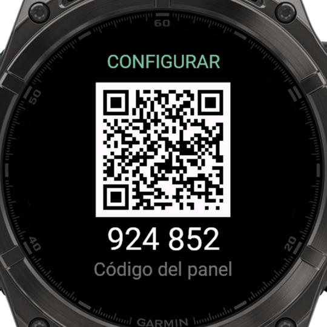

# Mi Asistente — Garmin fēnix 8

Asistente personal por voz para el **Garmin fēnix 8 47mm AMOLED**, desarrollado
con Connect IQ (Monkey C) y un backend serverless en Vercel. Responde en
pantalla y por el altavoz del reloj, con el contexto de tus tareas, tus notas y
los datos de salud y actividad del propio reloj. Incluye un módulo de práctica
de japonés (nivel N5) y un panel web para administrarlo desde el teléfono.

El diseño de la interfaz se inspira en [Monki](https://github.com/Niicko12/monki),
el asistente de la Anbernic RG353V.

<p align="center">
  
  
  
</p>

<sub>Capturas del simulador de Connect IQ (fēnix 8 47mm) con datos de ejemplo.</sub>

## Funciones

| Función | Descripción |
|---|---|
| **Preguntas por voz** | La app empieza a escuchar al abrirse (hasta 12 s; un toque termina la grabación). El audio se transcribe y se responde en segundos. |
| **Respuesta hablada** | La respuesta se reproduce por el altavoz del reloj, frase a frase, con la boca animada. |
| **Contexto del reloj** | Cada pregunta incluye batería, pasos, calorías, distancia, pisos, minutos de intensidad, pulso actual y en reposo, Body Battery, estrés, SpO2, respiración, recuperación, VO2máx, horario de sueño, clima y amanecer/atardecer. |
| **Tareas y notas** | Se guardan en el reloj, con plantillas o teclado, y acompañan cada pregunta como contexto. |
| **Preguntas rápidas y proyectos** | Accesos directos a preguntas frecuentes y seguimiento de proyectos (último avance y siguiente paso). |
| **Japonés N5** | Tarjetas con lectura, romaji, significado y pronunciación; quiz de tres opciones que prioriza lo que fallas; quiz de hiragana; racha diaria. Los verbos se presentan en forma cortés ます con su traducción conjugada (たべます = «como (comer)»). |
| **Panel en el teléfono** | Menú → Configurar (QR): al escanear el QR del reloj, el teléfono abre el panel ya enlazado. Desde el panel se pregunta al asistente (y la respuesta puede guardarse como nota en el reloj), se agregan tareas, notas, preguntas rápidas, proyectos y tarjetas de japonés (la IA completa lectura, romaji y significado), y se administran las claves de IA. |
| **Estados visuales** | Ojos animados para disponible, escuchando, pensando, hablando, sin conexión y error. |

<p align="center">
  
  
  
  
</p>
<p align="center">
  
  
  
</p>

## Arquitectura

```text
fēnix 8 ──BLE──▶ iPhone (Garmin Connect) ──HTTPS──▶ Vercel (integration-service)
  │                                                    │
  │  micrófono: Ogg/Opus 16 kHz                         ├─ Voz a texto: Whisper (Groq)
  │  datos del reloj + tareas + notas                   ├─ Respuesta: Groq ─▶ NVIDIA ─▶ Gemini
  │                                                    ├─ Texto a voz: Gemini ─▶ Google Cloud ─▶ Edge
  │                                                    └─ Panel y sincronización: Vercel Blob (privado)
  ◀── respuesta (JSON) y voz por partes (Ogg/Opus en base64)

iPhone (navegador) ──HTTPS──▶ /api/setup (panel) ──▶ /api/config
```

- **Seguridad:** las claves de IA nunca se guardan en el reloj; el reloj se identifica con un token de dispositivo. Las claves que se cargan desde el panel se almacenan cifradas (AES-256-GCM) en un Blob privado y tienen prioridad sobre las variables de entorno.
- **Enlace del panel:** el reloj solicita un código de un solo uso (válido 10 minutos y 5 intentos) y descarga un QR que lo incluye; al escanearlo, el teléfono lo canjea por una sesión. El código también se muestra para escribirlo a mano. El token del dispositivo nunca se escribe en el teléfono.
- **Alta disponibilidad:** cada servicio tiene proveedores de respaldo en cadena; un proveedor sin cuota se omite temporalmente.
- **Voz por partes:** la respuesta se divide en frases y el reloj solicita la siguiente mientras reproduce la actual, para mantener cada transferencia ligera.
- **Sincronización:** al abrir el menú, el reloj recoge lo agregado en el panel (`/api/sync`) y confirma lo guardado.
- **Tipografía japonesa:** `tools/make_font.py` genera una fuente BMFont con el hiragana y katakana completos y los kanji del mazo. Las tarjetas creadas desde el panel se muestran con su lectura en kana cuando un kanji no forma parte de la fuente.

## Estructura

```text
mi-asistente-garmin/
├── garmin-connect-iq/          app del reloj (Monkey C)
│   ├── manifest.xml
│   ├── Secrets.mc.example      plantilla de URL y token (Secrets.mc no se versiona)
│   ├── resources/              textos, icono, QR del panel y fuente japonesa
│   ├── source/
│   │   ├── ListenView.mc       escuchar ▶ enviar ▶ responder
│   │   ├── AnswerPanel.mc      respuesta adaptada a pantalla redonda
│   │   ├── SpeechPlayer.mc     voz por partes con Audio.Output
│   │   ├── VoiceRecorder.mc    micrófono con Audio.Capture
│   │   ├── WatchData.mc        datos del reloj enviados con cada pregunta
│   │   ├── EyesRenderer.mc     cara animada
│   │   ├── Jp*.mc, JapaneseDeck.mc   módulo de japonés
│   │   ├── JpCustom.mc         tarjetas creadas desde el panel
│   │   ├── JpCharset.mc        caracteres de la fuente (generado)
│   │   ├── SetupQrView.mc      QR y código de enlace del panel
│   │   ├── PhoneSync.mc        sincronización con el panel
│   │   └── Theme.mc            colores compartidos
│   └── test/                   pruebas unitarias (Connect IQ Test)
├── integration-service/        backend en Vercel (Node.js + TypeScript)
│   ├── api/ask.ts              pregunta escrita
│   ├── api/ask-audio.ts        pregunta hablada
│   ├── api/speak.ts            voz por partes
│   ├── api/setup.ts            panel web para el teléfono
│   ├── api/pair.ts             código de enlace del panel
│   ├── api/qr.ts               QR con el código de enlace
│   ├── api/config.ts           API del panel
│   ├── api/sync.ts             sincronización con el reloj
│   └── lib/                    proveedores de IA y voz, configuración y codificador Ogg/Opus
├── tools/
│   ├── mtp_send.py             instalación en el reloj por MTP
│   └── make_font.py            fuente japonesa y JpCharset.mc
└── docs/                       plan, validación de capacidades, capturas y mockup
```

## Puesta en marcha

### Backend

```bash
cd integration-service
npm install
vercel link
vercel env add DEVICE_TOKEN production     # p. ej. openssl rand -hex 32
vercel env add GROQ_API_KEY production
vercel env add NVIDIA_API_KEY production   # opcional
vercel env add GEMINI_API_KEY production
vercel blob create-store mi-asistente-config --access private   # almacenamiento del panel
vercel deploy --prod
```

Endpoints y variables en [integration-service/README.md](integration-service/README.md).

### App del reloj

Requisitos: [Connect IQ SDK](https://developer.garmin.com/connect-iq/sdk/)
con el dispositivo `fenix847mm`, Java 17 y una clave de desarrollador:

```bash
openssl genrsa -out developer_key.pem 4096
openssl pkcs8 -topk8 -inform PEM -outform DER -in developer_key.pem -out developer_key.der -nocrypt
cp garmin-connect-iq/Secrets.mc.example garmin-connect-iq/source/Secrets.mc   # completar URL y token
```

Compilar y ejecutar en el simulador:

```bash
export PATH="/opt/homebrew/opt/openjdk@17/bin:$PATH"
SDK="$(cat ~/Library/Application\ Support/Garmin/ConnectIQ/current-sdk.cfg)"
cd garmin-connect-iq
"${SDK}bin/monkeyc" -d fenix847mm -f monkey.jungle -o bin/MiAsistente.prg -y ../developer_key.der
"${SDK}bin/connectiq" &
"${SDK}bin/monkeydo" bin/MiAsistente.prg fenix847mm
```

Pruebas unitarias:

```bash
"${SDK}bin/monkeyc" -d fenix847mm -f monkey.jungle -o bin/test.prg -y ../developer_key.der -t
"${SDK}bin/monkeydo" bin/test.prg fenix847mm -t
```

### Instalación en el reloj

El fēnix 8 se conecta por MTP. Con el reloj conectado directamente al Mac en
modo MTP (requiere `brew install libmtp`):

```bash
mtp-folders | grep -A1 GARMIN       # ID de la carpeta Apps
python3 -I tools/mtp_send.py "$PWD/garmin-connect-iq/bin/MiAsistente.prg" <ID>
```

La app se instala al desconectar el cable.

## Uso

- **Acceso rápido:** asigna Mi Asistente a una tecla (Ajustes → Sistema → Teclas de acceso rápido) para preguntar al instante.
- **Preguntar:** habla al abrir la app; un toque termina la grabación o inicia otra pregunta. UP/DOWN desplaza respuestas largas.
- **Panel:** Menú → Configurar (QR) y escanea el QR con el iPhone: el panel se abre enlazado. Los cambios llegan al reloj al abrir su menú.
- **Quiz de japonés:** toca una opción, o muévete con UP/DOWN y confirma con START.

<p align="center">
  
</p>

## Mantenimiento

Regenerar la fuente japonesa tras modificar el mazo (requiere Pillow y `tools/fonts/NotoSansJP.ttf`):

```bash
python3 -I tools/make_font.py tools/fonts/NotoSansJP.ttf garmin-connect-iq/source/JapaneseDeck.mc \
  garmin-connect-iq/resources/fonts 34 garmin-connect-iq/source/JpCharset.mc
```

Regenerar el QR si cambia la URL del backend (requiere `pip install segno`):

```bash
python3 -c "import segno; q=segno.make('https://mi-asistente-garmin.vercel.app/api/setup', error='m'); \
q.save('garmin-connect-iq/resources/drawables/setup_qr.png', scale=6, border=2); q.save('docs/setup-qr.png', scale=10, border=4)"
```

## Documentación

- [Plan del proyecto](docs/plan.md)
- [Validación de capacidades del fēnix 8](docs/capability-validation.md)
- [Mockup original](docs/mockup-original.png)

## Créditos

[Noto Sans JP](https://fonts.google.com/noto/specimen/Noto+Sans+JP) (SIL OFL, ver `tools/fonts/OFL.txt`) ·
[opusscript](https://github.com/abalabahaha/opusscript) ·
[msedge-tts](https://github.com/Migushthe2nd/MsEdgeTTS) ·
[mpg123-decoder](https://github.com/eshaz/wasm-audio-decoders) ·
diseño de la cara inspirado en [Monki](https://github.com/Niicko12/monki).
